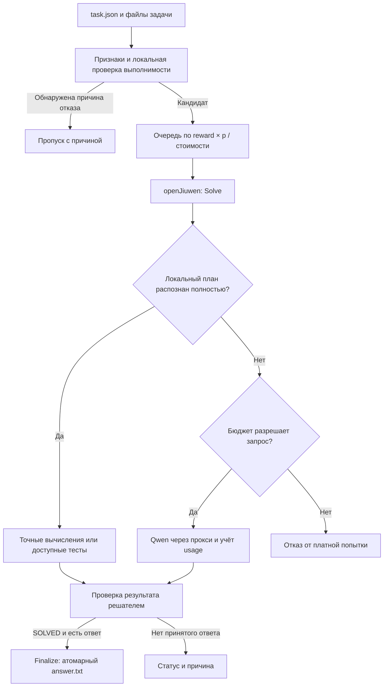
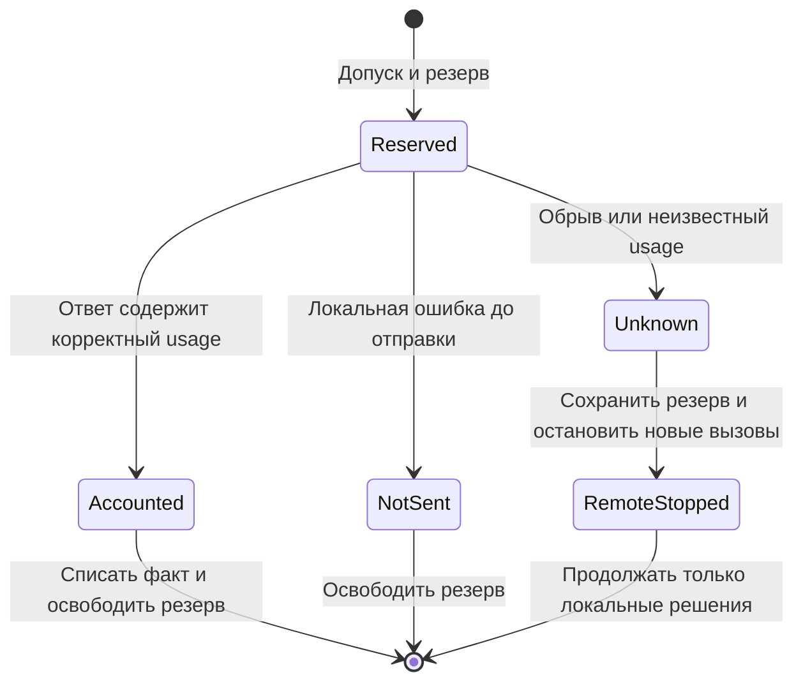

# Budget-Aware Agent Harness

**Больше баллов на один токен.** Харнесс на базе **openJiuwen 0.1.19** решает задачи `coding`, `data_analysis`, `math` и `search` под общим бюджетом: оценивает стоимость до запуска, выбирает порядок по ожидаемой отдаче, использует локальные вычисления и сохраняет каждый полученный ответ сразу.

[Быстрый запуск](#быстрый-запуск) · [Архитектура](#архитектура) · [Бюджет и очередь](#бюджет-и-очередь) · [Результаты](#результаты) · [Траектории](#траектории-и-воспроизводимость) · [Графы гипотез](HYPOTHESES.md) · [Проверка контейнера](docs/CONTAINER.md)

| Выбранная конфигурация | Известный смешанный набор | Дефицит бюджета | Локальная проверка |
|---|---|---|---|
| `calibrated + csv-roomy`, исходный math-prompt | **26/26**, **78/78 баллов** — E129 | **105 против 71 балла**, бюджет 500 — E115 | **241 тест**, Linux / Python 3.11.10 |

Результаты относятся к сохранённым авторским экспериментам. Скрытый набор организаторов не запускался. Новая упаковка сохраняет алгоритмы выбранного релиза E132; Linux-проверка и ограничения её применимости описаны [отдельно](docs/CONTAINER.md).

## Быстрый запуск

Сборка выполняется из корня репозитория. Нужны Docker и Linux-контейнеры; lockfile рассчитан на `linux/amd64` и Python 3.11.

```bash
timeout 1000s docker build -t hack:latest .
docker images --format '{{.Repository}}:{{.Tag}} -> {{.Size}}'
```

Перед запуском задайте `TASKS` — абсолютный путь к **рабочей копии** задач, `TEAM` — имя команды, `LLM_BASE_URL` — полный URL прокси с `/v1`, `LLM_API_KEY` — ключ и `BUDGET` — выданный бюджет. Ключ передаётся только через окружение. Задачные каталоги и редактируемые coding-файлы должны быть доступны пользователю контейнера на запись.

```bash
timeout -k 1000s 1h docker run --rm --name "run-${TEAM}" \
  --network hack-net \
  -e LLM_BASE_URL -e LLM_API_KEY -e BUDGET \
  -v "$TASKS:/data/tasks:rw" \
  --read-only --tmpfs /tmp:rw,size=2g -e HOME=/tmp \
  --cap-drop ALL --security-opt no-new-privileges \
  --cpus 4 --memory 16g --pids-limit 512 \
  --workdir /app --entrypoint python \
  hack:latest \
  /app/run_agent.py --tasks-dir /data/tasks
```

Это контракт запуска организаторов с явной передачей `BUDGET` из последнего уточнения. Выбраны 4 CPU по текстовому ограничению регламента; команда с `--cpus 8` также совместима. Сеть `hack-net` должна быть создана проверяющей инфраструктурой и обеспечивать доступ к прокси.

**Результат сдачи — `/data/tasks/<task_id>/answer.txt`.** Отдельный общий файл для штатной команды не обязателен. В опубликованной команде `OUT` не монтируется и не передаётся; один `mkdir "$OUT"` на хосте не делает его доступным контейнеру. Если нужна дополнительная сводка, создайте доступный для записи каталог и добавьте:

```bash
-v "$OUT:/data/out:rw" -e OUT=/data/out/solutions.json
```

При запуске пакеты, данные и веса не скачиваются. В образ попадают только runtime, полный набор зависимостей и встроенные константы калибровки. Локальные нейросетевые модели не используются.

## Архитектура

На каждую задачу создаётся отдельный настоящий `openJiuwen.Workflow`: `Start → Solve → Finalize → End`. SDK управляет исполнением и передачей результата; HTTP-запросы внутри `Solve` выполняет собственный мост с общим учётом бюджета. Отсутствие SDK завершает запуск ошибкой, а не скрытым переходом на другую реализацию.



Локальный путь выполняется **перед LLM внутри каждой задачи**. Отдельного глобального прохода по всем бесплатным задачам в текущем scheduler нет. Очередь продолжает обрабатывать локальные решения даже при бюджете 0 или остановке удалённых вызовов.

### Четыре доменных решателя

| Тип | Локальный путь | LLM-путь и проверка |
|---|---|---|
| `search` | Индекс карточек `kb/*.md`, обход распознанных цепочек до 8 переходов, объединение совместимых фактов и проверка конфликтов на пути ответа | Ограниченный контекст связанных карточек, включая обратные связи; короткий ответ либо отказ. Общего доказательства корректности ответа LLM нет |
| `data_analysis` | Разобранные расчётные планы, точная арифметика `Fraction`; поддерживаемые CSV JOIN с учётом повторяющихся строк | Python для неподдержанных формулировок; многотабличный путь запускает код на временных копиях CSV, проверяет их неизменность и согласованность `stdout`/`answer.txt` |
| `math` | Полностью распознанные последовательности складских операций с округлением на нужных шагах | Короткая программа Python, ограничение времени, ответ из `stdout`. Успешное исполнение само по себе не доказывает правильность программы |
| `coding` | Запуск доступных `test_*.py`; уже корректный код получает `DONE` без API | Выбор целевого модуля, контекст зависимостей и ошибок, проверка синтаксиса AST, тесты во временной копии, защита тестовых файлов и сохранение успешного патча |

Исполнение Python в подпроцессе и временная рабочая папка не являются отдельной защищённой ОС-песочницей. Math-fallback исполняется в рабочем каталоге задачи. Изоляцию процесса от хоста обеспечивают внешние ограничения Docker; скрытые тесты проверяет организатор.

## Бюджет и очередь

### 1. Прогноз до решения

[`feature_extractor.py`](harness/planner/feature_extractor.py) собирает тип, награду, длину инструкции, число и размер файлов, признаки CSV/KB, результаты доступных coding-тестов и признаки отсутствующих данных. Обращения к LLM для этой стадии не нужны.

[`TokenCostEstimator`](harness/planner/token_estimator.py) использует эвристические оценки стоимости и вероятности успеха. В релизе нет обученных весов: поля загрузки регрессора/классификатора не означают, что `estimate()` использует ML-предсказания. Скрипт обучения — исследовательский инструмент.

Калиброванная очередь сортирует задачи по:

```text
priority(i) = reward(i) × p_heuristic(i) / median_cost[type(i)]
```

| Тип | Медиана приведённых токенов из E92 |
|---|---:|
| `math` | 19.00 |
| `search` | 19.30 |
| `coding` | 100.90 |
| `data_analysis` | 107.65 |

Медианы зафиксированы в [`ranking_calibration.py`](harness/planner/ranking_calibration.py) и влияют **только на порядок**. Выделение бюджета задачи использует отдельную исходную оценку `expected_cost`. Это эвристическая стратегия распределения бюджета, не точное решение задачи оптимизации и не гарантия максимального score.

### 2. Допуск HTTP-запроса

[`BudgetTracker`](harness/planner/budget_tracker.py) разделяет уже потраченные токены и резервы запросов. Перед отправкой под `asyncio.Lock` проверяются общий остаток и лимит задачи; при необходимости уменьшается `max_tokens`.

```text
effective_cost = input_tokens / 10 + visible_output_tokens + reasoning_tokens
input_estimate = len((system_prompt + user_prompt).encode("utf-8")) + 1024
reservation = input_estimate / 10 + output_cap
```

Оценка входа по байтам с запасом — эвристика, не точный токенизатор и не доказанная верхняя граница. Фактический расход берётся из `usage`, включая все входные токены без скидки на кэш. Если факт превысил резерв, новые платные вызовы останавливаются.

### 3. Списание и остановка



Учёт происходит **до** разбора `choices`: оплаченный, но некорректный или обрезанный ответ тоже учитывается. Автоматических HTTP-retry нет; узлы workflow используют `max_retries=0`. Возврат `DEFERRED_BUDGET` разрешён для ещё не оплаченных задач, временно заблокированных резервами других сессий.

### 4. Выбор модели

| Вызов | Модель в стандартном пути |
|---|---|
| `math`, первый ремонт `coding` | `qwen3.8-27b-noreason` |
| `search`, `data_analysis` | `qwen3.6-35b-a3b-noreason` |

В коде перечислены четыре разрешённые модели. При этом стандартная конфигурация сохраняет `reasoning_usage_mode="unverified"`: reasoning-вызов блокируется **до HTTP**, пока контракт включения reasoning в `completion_tokens` явно не задан. Парсер поддерживает `included` и `separate`, чтобы не пропустить и не удвоить расход; CLI не переключает этот режим. Поэтому наличие reasoning-fallback в роутере не означает его активность в сдаваемом профиле.

## Поиск невыполнимых задач

Фильтр до API проверяет пустую инструкцию, отсутствие необходимых данных и деление на ноль в полностью распознанном арифметическом плане. Потенциально конфликтующие тесты не отбрасываются только по совпадению текста выражений: результат может зависеть от состояния.

Доменные решатели дополнительно обнаруживают отсутствующие факты, конфликты в используемых KB-связях и неподдержанные условия. Неполный разбор ведёт к следующему пути или неопределённому результату. Ответ модели `UNSOLVABLE` остаётся отказом модели, а не универсальным доказательством невыполнимости.

`UNKNOWN`, `FAILED`, `BUDGET_EXCEEDED`, `DEFERRED_BUDGET` и ошибки API имеют разные причины; нехватка бюджета не доказывает невозможность задачи. На E129 из пяти невыполнимых задач три получили обоснованный отказ по проверяющему коду, ещё две завершились без решения. Гарантия обнаружения всех невыполнимых задач не заявляется.

## Вход, выход и настройки

Каждый подкаталог содержит `task.json` с полями `task_id`, `task_type`, `instruction`, `reward`. Файлы задачи могут лежать рядом или в `workspace/`.

```json
{
  "task_id": "example",
  "task_type": "math",
  "instruction": "A warehouse starts with 100 boxes. It ships 3 boxes per day for 4 days. How many boxes does it have at the end?",
  "reward": 3
}
```

При `SOLVED` и наличии ответа `Finalize` сразу записывает `answer.txt` в корень задачи и дублирует его в `workspace/`, если он есть. Запись идёт через временный файл, `flush`, `fsync` и `os.replace`. Coding также сохраняет исправленный целевой модуль; текст ответа — `DONE`. Не нужно ждать завершения всего пула, чтобы уже сохранённая задача попала на проверку.

Если задан `OUT`, после каждого принятого решения обновляется JSON `{task_id: answer}`. Для существующего каталога используется `solutions.json`. Его родитель должен существовать; ошибка дополнительной сводки подавляется текущей реализацией. Основной артефакт сдачи — файл в каталоге задачи.

Важно: `Finalize` управляет штатной записью, но сгенерированная math-программа может сама записать файл до возвращения статуса. Поэтому диагностический `SOLVED` и фактически сохранённые ответы проверяются отдельно; именно такое расхождение обнаружено в E130–E132.

| Параметр | Значение / поведение |
|---|---|
| `--tasks-dir`, затем `TASKS` | По умолчанию `/data/tasks` |
| `--budget` → `BUDGET` → `TOKEN_BUDGET` | Затем 100000; это запасное значение, не обещанная квота |
| `LLM_BASE_URL`, `LLM_API_KEY` | Прокси и ключ из окружения; реальных значений в образе нет |
| `--out-file`, затем `OUT` | Необязательный общий JSON |
| `--profile` | По умолчанию `csv-roomy`; другие профили — для сравнений |
| `--ranking-policy` | По умолчанию `calibrated`; `roi` возвращает исходную очередь |
| `--max-concurrency` | В стандартном профиле **1**, допустимо 1–5; CLI ограничивает диапазон |
| `--max-api-calls` | По умолчанию без отдельного лимита числа вызовов |

В `csv-roomy` включены поддерживаемые JOIN; минимумы бюджета задачи `search/data/coding` — 300/1000/800, каждый ограничен общим остатком. Multi-CSV output cap — 600. Таймаут запроса — 60 секунд, workflow — 180 секунд. Общий часовой лимит задаёт внешняя команда `timeout`.

Логи и бюджетный журнал пишутся в `/tmp/openjiuwen_logs/`. После `docker run --rm` они исчезают, если каталог отдельно не смонтирован. В stdout выводится диагностическая оценка score, а не результат скрытых тестов.

## Результаты

### Полная регрессия выбранного runtime: E129

31 задача: 26 выполнимых и 5 невыполнимых. Лимит эксперимента — **3000**, фактический расход — **1820.2** приведённого токена, **23 HTTP-запроса**. В эксперименте был дополнительный предел 30 вызовов; в стандартном запуске его нет.

| Тип | Решено выполнимых | Баллы |
|---|---:|---:|
| `coding` | 5/5 | 15/15 |
| `data_analysis` | 12/12 | 36/36 |
| `math` | 5/5 | 15/15 |
| `search` | 4/4 | 12/12 |
| **Всего** | **26/26** | **78/78** |

[Отчёт E129](experiments/E129_submission_baseline_live_20261113T092505061530/report.json) · [Аудит расхода](experiments/E129_submission_baseline_live_20261113T092505061530/independent_audit.json)

### Калибровка порядка при малом бюджете

| Серия | Бюджет | Исходный ROI: баллы / решено | Калиброванный: баллы / решено | Изменение score |
|---|---:|---:|---:|---:|
| [E107](experiments/E107_validation_summary.json) | 1000 | 96 / 26 | 122 / 37 | +27.1% |
| [E115](experiments/E115_interaction_summary.json) | 500 | 71 / 21 | 105 / 30 | +47.9% |

В обоих случаях пул содержит 100 задач, 83 выполнимые, максимум 246 баллов. E107 — историческая версия: у калиброванной ветви было два неверных `SOLVED`, поэтому сразу её не приняли. Ошибки исследовали и исправляли до последующих серий. E115 сравнивает более позднюю реализацию; расход ROI/calibrated — 373.3/373.1, неверных `SOLVED` — 0/0. Часть контрольных прогонов переиспользована, наборы содержат знакомые семейства и копии: это не независимый финальный benchmark.

### Выбор релиза: E131–E132

| Набор и бюджет | Исходный math-prompt | Короткий math-prompt |
|---|---:|---:|
| Расширенный известный набор, 43 задачи, 3000 | **99/105** | 94/105 |
| Новый авторский набор, 18 задач, 800 | 15/48 | **17/48** |
| Тот же новый набор, 2000 | 26/48 | **27/48** |
| **Сумма баллов трёх прогонов** | **140** | 138 |
| Расход приведённых токенов | 4276.3 | **3824.7** |

Выбран исходный промпт по сумме reward. 140 — сумма трёх прогонов, причём новый набор повторяется на двух бюджетах. После аудита критерий изменили с внутреннего статуса на правильный сохранённый файл; исходные данные и поправка сохранены в [E131](experiments/E131_score_selection_summary.json). Это выбор среди двух проверенных кандидатов с небольшим перевесом, не доказательство глобального оптимума.

Короткие math-промпты, AST-перепроверка числовых констант, универсальный JSON-evidence для search и двухпроходная очередь **не включены в стандартный путь**. Полный журнал, отрицательные результаты и графы развития находятся в [HYPOTHESES.md](HYPOTHESES.md).

## Траектории и воспроизводимость

Основные данные собраны в `experiments/`; `trajectories/summary_stats.json` содержит только старую сводку восьми примеров и не заменяет историю экспериментов.

Пример полной траектории — [каталог E129](experiments/E129_submission_baseline_live_20261113T092505061530):

| Артефакт | Что можно проверить |
|---|---|
| `ranking.json` | Исходную очередь, признаки и оценки |
| `request_*.json` | ID задачи, модель, промпты, выходной лимит; без Authorization-заголовка |
| `response_*.json` | Фактический ответ API и usage |
| `report.json` | Конфигурацию, статусы, результаты по типам, workflow и бюджет |
| `independent_audit.json` | Пересчёт расхода по ответам API |
| `task_artifacts/` | Сохранённые ответы и состояние файлов после решения |

Генераторы, сравнения политик и проверки результатов находятся в [`scripts/`](scripts/). Траектории использованы для замораживания медианных стоимостей E92; нейросетевая модель на них не обучалась. Исторический [манифест E132](release/source_manifest.json) относится к прежней упаковке. После обновления зависимостей нельзя представлять его как хеш нового Docker-образа.

### Проверки без ключа и без расхода токенов

```bash
python -m venv .venv
. .venv/bin/activate
python -m pip install -r requirements.lock
python -B -m unittest discover -s tests -q

# Требует предварительно собранный образ. Сеть отключена полностью.
python scripts/container_smoke.py --image hack:latest
```

Smoke-проверка запускает настоящий SDK, четыре локально решаемые задачи и отрицательный пример с отсутствующим CSV. Проверяет `answer.txt`, дубликаты в `workspace/`, общий `OUT`, целостность входов, отсутствие HTTP-попыток и размер образа менее 4 GB. Она не заменяет отборочный прогон двух задач с реальным прокси.

Для диагностики без Docker доступен `python scripts/container_smoke.py --python /absolute/path/to/python`. Этот режим проверяет только host CLI. Подробности сборки, фактические проверки и остающиеся ограничения — в [docs/CONTAINER.md](docs/CONTAINER.md).

## Навигация по коду

| Путь | Назначение |
|---|---|
| [`run_agent.py`](run_agent.py) | CLI, бюджет из окружения, профиль и логирование |
| [`harness/workflow_runner.py`](harness/workflow_runner.py) | Реальный openJiuwen Workflow и финализация |
| [`harness/planner/`](harness/planner/) | Признаки, фильтр, стоимость, очередь и бюджетный журнал |
| [`harness/agents/`](harness/agents/) | Доменные решатели, локальные планы, контекст и HTTP-мост |
| [`harness/sandbox/`](harness/sandbox/) | Запуск Python и атомарная запись ответов |
| [`Dockerfile`](Dockerfile), [`requirements.lock`](requirements.lock) | Контейнер и точные версии всех runtime-зависимостей |
| [`tests/`](tests/), [`scripts/`](scripts/) | Регрессии и воспроизводимые эксперименты |
| [`HYPOTHESES.md`](HYPOTHESES.md) | Реестр гипотез, графы и история решений |

Лицензия: [MIT](LICENSE).
